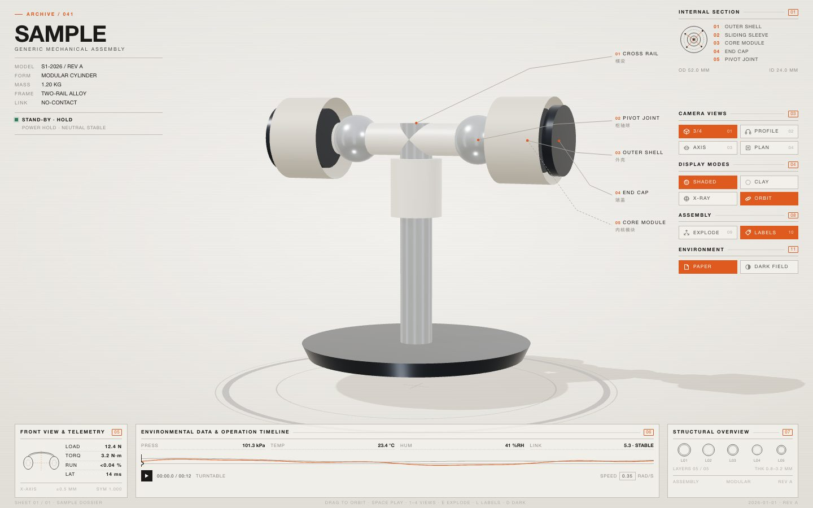
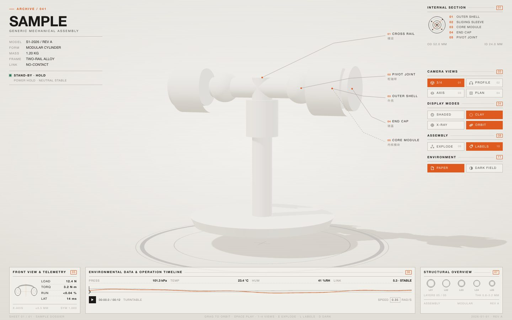
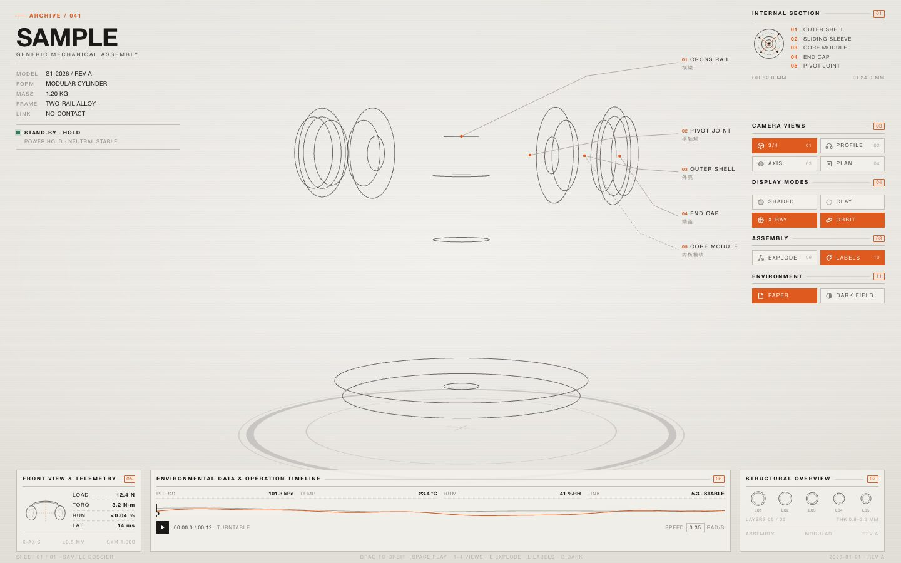
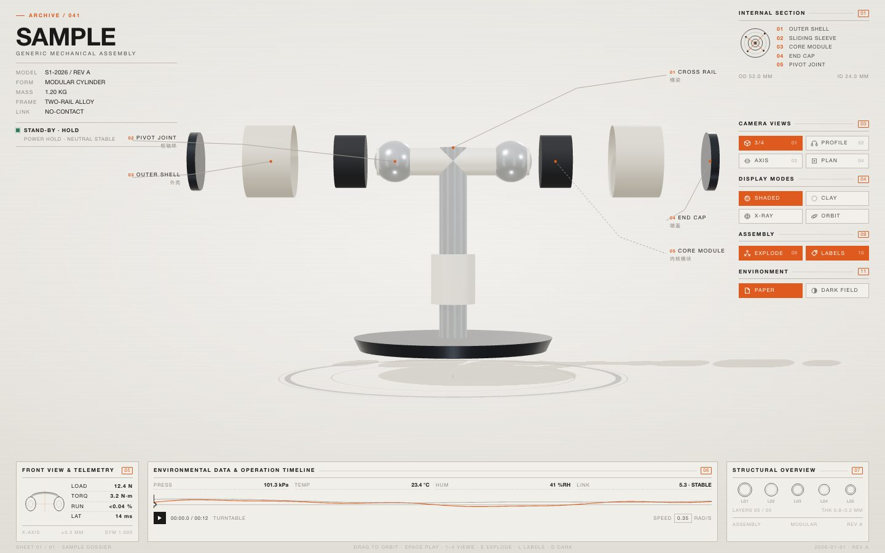
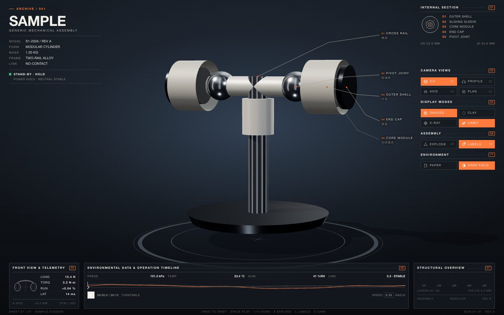

# three-dossier

A single-file, interactive 3D product dossier page: a turntable stage, an exploded
assembly view, projected callouts, paper/dark themes, and separate desktop and mobile
layouts — built down to one self-contained HTML file.



Open `examples/sample/dossier.html` in a browser. No server, no network access, no
install step.

| | |
|---|---|
| Interaction | Drag to orbit · wheel / **two-finger pinch** to zoom · three display modes (shaded / clay / x-ray) · explode and reset · callout toggle · paper and dark field · four camera presets |
| Output | One HTML file with three.js, CSS and JS inlined (780 KB, 205 KB gzipped) |
| Requirements | To view: nothing — open the HTML. To build: Node ≥ 18. The output itself has zero runtime dependencies |
| Engine | three.js r186 (MIT) |

| Clay | X-ray |
|---|---|
|  |  |

| Exploded | Dark field |
|---|---|
|  |  |

## Run it in 30 seconds

**To just look at it** — no install, no build, no server:

```bash
open examples/sample/dossier.html
```

The artifact is one self-contained HTML file: three.js, the styles and the
application code are all inlined. Copy that one file anywhere and it still works,
including straight off a `file://` path.

**To change the code** — this needs Node ≥ 18:

```bash
npm install
npm run build          # → examples/sample/dossier.html
open examples/sample/dossier.html
```

While working on it:

```bash
npm run dev            # watch src/, rebuild on change
npm run build:debug    # unminified + inline sourcemap, for readable stack traces
```

`npm run dev` and `npm run build:debug` write to `examples/sample/dossier.dev.html`,
which is gitignored — they never overwrite the committed artifact.

A fresh build reproduces the committed artifact byte for byte, so a clone that has
not been built yet is already usable.

## Swap in your own product

The page has two layers. **kit** is the engine and knows nothing about any particular
product; **product** is a slot, one directory per product.

```
src/kit/                engine: stage, camera, materials, explode, callouts,
                        theme, layout, HUD, main loop
src/products/sample/    slot: config.js (behaviour) + rig.js (geometry)
src/app/                assembly: main.js wiring + index.html shell + dossier.css
```

Three things change when you add a product:

1. Copy `src/products/sample/` to `src/products/<your-product>/`
2. `rig.js` — `createRig()` returns `{ root, bounds, parts, joints, mat }`
3. `config.js` — camera presets, callout anchors, explode offsets, HUD layer names

Then point the import in `src/app/main.js` at your product:

```js
import product from '../products/<your-product>/config.js';
```

The kit does not change. The full field-by-field contract is in
[docs/契约.md](docs/契约.md) — read that page first.

Copy (model numbers, specifications, panel headings) lives in `index.html`, not in
`config.js`. That copy is a designed layout; it does not belong in strings assembled
by JavaScript.

### The bundled product is a placeholder

`src/products/sample/` is a deliberately generic assembly — a base, a column, a
sleeve, a cross rail, two pivot balls, and a coaxial shell/core/cap module on each
side. It exists so the engine has something to drive: every anchor type
(`root` / `part` / `parts` / `joints`), every explode layer, every display mode has
something to point at. It is built from primitives only — no textures, no proprietary
geometry, no product data. Replace the whole directory with your own.

## Why a single file

The way a dossier page gets used is "send it to someone and let them look". A version
that ships as a folder of assets asks the recipient to start a server, deal with
cross-origin rules, and worry about paths. A single file opens on double-click and
survives being passed around.

The cost is the first-paint payload: the whole of three.js ships inline. 780 KB
uncompressed is fine for a page like this; gzipped it is 205 KB, comparable to one
large image.

## Using it as a skill

`SKILL.md` is written in the agent-skill format: when it applies, the order to
integrate a new product, acceptance gates, and the five most common pitfalls. Every
path inside it is relative to the repository root.

To let an agent pick it up, place this directory in whatever skill directory your
agent reads — the layout convention differs between agents, so follow yours rather
than a path given here. A symlink into that directory works and avoids duplicating
the checkout:

```bash
ln -s "$PWD" <your-agent's-skill-directory>/three-dossier
```

The agent then reads `SKILL.md` and works from `src/` directly. It does not need the
committed artifact, and it does not need a build until it has changed something.

## Known trade-offs

- **WebGL 2 only.** three.js dropped WebGL 1 in r163; older devices get a blank page.
- **Callouts are DOM, not 3D text.** Readability and typesetting come at the cost of
  a projection every frame plus label collision avoidance (see `kit/callouts.js`).
- **Explode moves along one axis per layer.** The `off` vector of each part decides
  the direction; a product with many layers has to lay those out itself.
- **No physics or collision.** Parts interpolate between positions and never check
  for interpenetration, so leave clearance between layers.
- **The stage is lit for a light product.** Dark and metallic materials need the
  `stage.lights` and `stage.env` overrides in `kit/stage.js`.

## Pitfalls

[docs/坑.md](docs/坑.md) collects the traps this code has already fallen into: why
edges must be children of their mesh, why hiding a solid cannot use `visible=false`,
why `1fr` is not equal-width, what happens when `viewport-fit=cover` is missing, and
how esbuild's `$` and `$$` handling collides with jQuery-style helpers.

Read it before you copy any of this code — each of those cost hours to track down.

## License

MIT — see [LICENSE](LICENSE).

The bundled artifact also carries the full text of the three.js MIT license as an
HTML comment at the end of the file, since it contains three.js code.
</content>